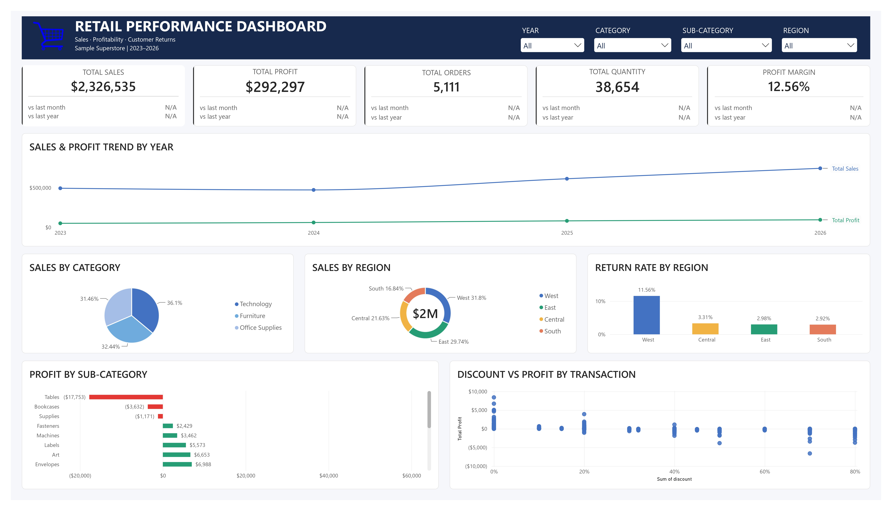

# Retail Sales & Profitability Analysis

Project Type: Personal Data Analytics Project  
Role: Data Analyst  
Tools: Microsoft Excel, MySQL, Power BI  
Dataset: Sample Superstore  
Data Period: January 2023 – December 2026

## Project Overview

This project analyzes retail transaction data to evaluate sales performance, profitability, customer behavior, discount patterns, and product returns. Microsoft Excel was used for data cleaning and preparation, MySQL for data validation and business analysis, and Power BI for interactive dashboard development. The objective was to identify business performance patterns and translate the findings into actionable recommendations.

## Tools & Workflow

- Excel: Cleaned, standardized, and prepared transaction data.
- MySQL: Validated data and analyzed sales, profitability, customers, discounts, and returns.
- Power BI: Developed an interactive dashboard with KPI cards, visualizations, and filters.

## Dashboard Preview

**Key KPIs**

| Metric | Result |
|---|---:|
| Total Sales | $2,326,534.52 |
| Total Profit | $292,297.40 |
| Total Orders | 5,111 |
| Total Quantity | 38,654 |
| Profit Margin | 12.56% |

**Dashboard Features**
- Annual sales and profit trends
- Category and regional performance
- Profit by sub-category
- Discount versus profit analysis
- Regional return rates
- Filters for Year, Category, Sub-category, and Region

## Key Findings

**1. Sales Growth and Profitability**

Sales increased from $494,040.27 in 2023 to $745,567.44 in 2026. However, profit margin declined from 13.46% in 2025 to 12.87% in 2026.

**2. Category Performance**

Technology generated the highest sales ($839,893.35) and profit ($146,544.02). Furniture had the lowest category profit margin at 2.61%.

**3. Loss Making Sub-Categories**

Tables recorded a negative profit of $17,753.32, followed by Bookcases at -$3,632.07 and Supplies at -$1,171.30.

**4. Discount Analysis**

Several high discount groups, particularly those with discounts of 50%–80%, recorded negative profit. The 0% discount group had a profit margin of 29.56%. This indicates an association between discount levels and profitability, not necessarily causation.

**5. Regional Returns**

The West region had the highest return rate at 11.56%, compared with 2.92%–3.31% across the other regions.

## Business Recommendations

- Review pricing, costs, and discount practices for loss-making sub-categories
- Investigate the high return rate in the West region
- Evaluate customer profitability alongside sales revenue
- Monitor profit margin alongside sales growth to support sustainable performance

## Project Files

- `sql/superstore_analysis_dashboard.jpg` — SQL queries for data validation and business analysis
- `images/superstore_analysis_dashboard.jpg` — Dashboard screenshot
- `excel/data q-log superstore_analysis.xlsx` — Data cleaning documentation

## Conclusion

This project demonstrates an end-to-end data analytics workflow using Excel, MySQL, and Power BI to transform retail transaction data into business insights and actionable recommendations.

---
